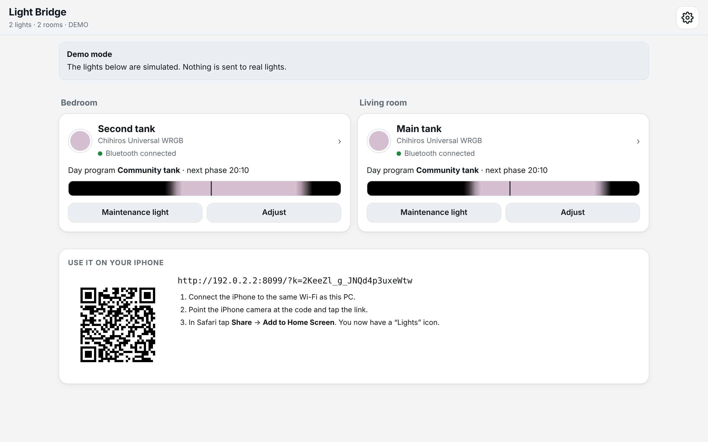
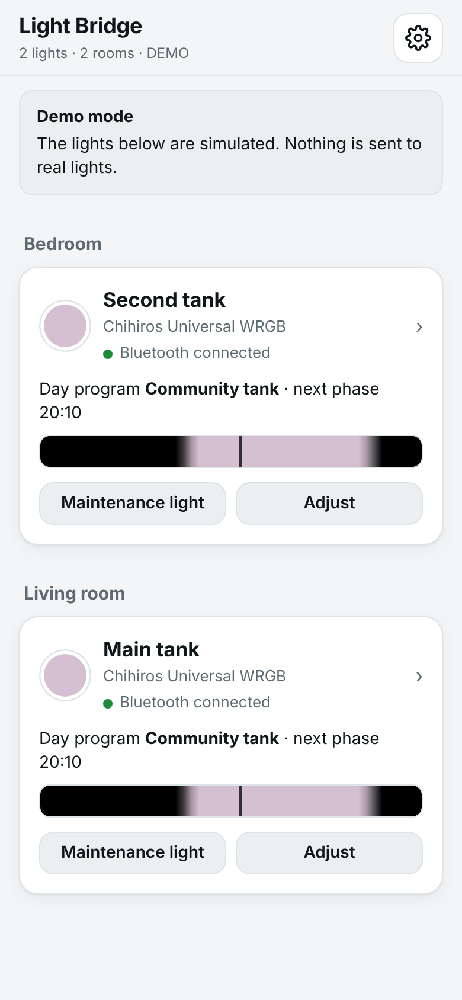
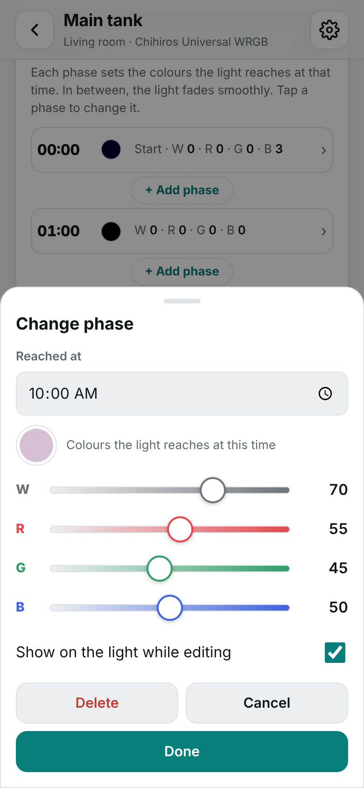
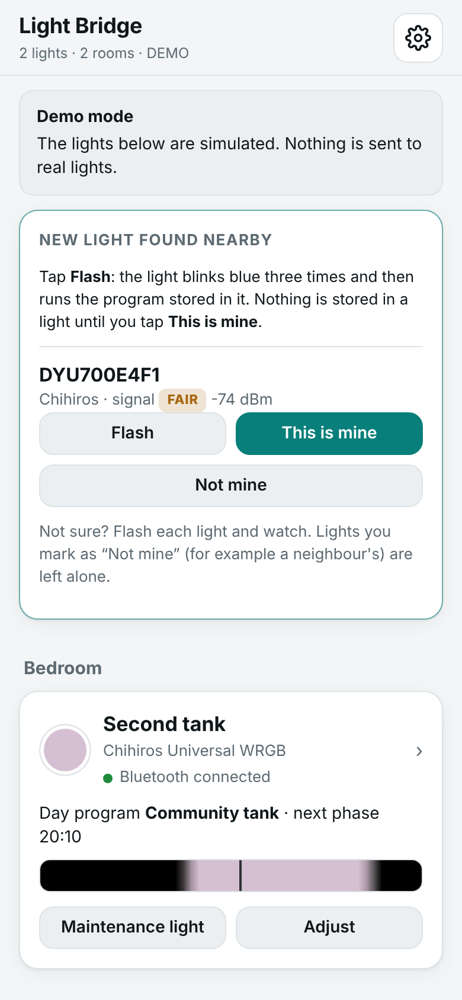

# Light Bridge

**One simple app for Chihiros aquarium lights — on the PC and the iPhone, without the vendor app.**

Light Bridge is a small program for a Windows laptop (macOS and Linux work too). It finds Chihiros
Universal WRGB lights over Bluetooth and stores a clear, phase-by-phase day program in each light.
The lights then run on their own. The laptop can go to work during the day, sleep or be switched off
at any time.



| Overview | Changing a phase | A new light nearby |
|---|---|---|
|  |  |  |

> Status: **0.11 — prototype for testing ("speedboat MVP").** It has been tested with simulated lights
> only. Read [Known limits](#known-limits) and the [review notes](docs/REVIEW.md) before relying on it.
> Not affiliated with Chihiros or Juwel.

## Why

The vendor app ("My Chihiros") makes everyday changes hard. The worst problem: the colour steps of a
day can only be set all at once. Light Bridge gives you:

- **Day programs made of phases** (HeliaLux style). Change one phase without touching the rest, and
  watch it live on the tank.
- **Templates** (community tank, aquascape, rift lake, Amazon …) and copy to another light.
- **Manual and maintenance light that ends on its own.**
- **Several lights in several rooms**, each with its own program, on one page.
- **No account, no cloud.** The iPhone uses the page the PC offers in the home Wi-Fi.

## Quick start

| | Windows | macOS / Linux |
|---|---|---|
| Real lights | double-click `Start-Light-Bridge.bat` | `./start-mac-linux.sh` |
| Try it with simulated lights | `Start-Demo.bat` | `./start-mac-linux.sh --demo` |
| Start with the PC | `Start-With-Windows.bat` (undo: `Stop-Starting-With-Windows.bat`) | launchd / systemd |

Requires Python 3.10+. The first start installs `bleak` into `%LOCALAPPDATA%\LightBridge\venv`
(Windows) or `.venv` (macOS/Linux). Open `http://localhost:8080` on the PC. For the iPhone, scan the
QR code shown in the app (it carries the access key, see [Security](#security)).

The step-by-step guide for non-technical users is [docs/Light-Bridge-Guide.pdf](docs/Light-Bridge-Guide.pdf).

## How it works: "lamp-first"

```
 iPhone / PC browser ──home Wi-Fi──▶ Light Bridge on the laptop ──Bluetooth──▶ Chihiros (room 1)
                                                               └─Bluetooth──▶ Chihiros (room 2)
```

The day program is **stored in each light**. The light runs it with its own clock. The bridge only:

1. writes the program and sets the clock when the laptop is near the light,
2. handles short, temporary changes (manual light, maintenance light, live preview),
3. switches the light back to its stored program afterwards.

What happens when the laptop leaves (taken to work, lid closed, out of range):

| At that moment the light… | What it does while the laptop is away | When the laptop is back |
|---|---|---|
| runs its program | keeps running it | nothing to do |
| shows manual / maintenance light | keeps that light (the app says *"still in manual light"*) | back to its program |
| was being written to | may have an unfinished program (the app says so) | written again at once |
| has a change waiting | runs the previous program | the change is written once the link is steady |

Safety rules in the code (see `light_bridge/chihiros.py`):

- A program write starts by erasing the light's program, so it only starts on a link that has been
  up for 8 s (not while walking past at the edge of range). An erased light is repaired at once.
- Before sleep and on shutdown, only the one short "run your program" command is sent. A full
  write is never started there.
- Every unfinished state is saved to disk at once and repaired on the next contact.
- Lights found nearby are **not touched** until the user confirms them ("This is mine").
  *Flash* lets a light blink so you can see which one it is.

### Two ways to store a program

| | Simple version (default) | Full curves (after an on-light test) |
|---|---|---|
| Commands | documented auto mode: one bright block per weekday group (`a5 19`), fade ≤150 min | per-channel curve points (`5a 06`), up to 20 phases |
| Shape | on → fade → full → fade → off; moonlight and breaks are left out | the whole curve |
| Weekdays | different programs per weekday | the same program every day |
| Status | documented by the community | captured on another Chihiros model; **unverified** on the WRGB, so the app runs a 4-minute test (the light should turn blue for 2 minutes) before using it |

The simple version is derived from the curve: "bright" means at least 25 % of the brightest moment
(sum of all colours), so dim moonlight is ignored. The light's own program cannot run over midnight;
a bright time across midnight is cut there and the app says so.

## Security

The bridge is meant for the home network, but a laptop is also used in other networks.

- **Access key.** Only the PC itself (localhost) can use the bridge without a key. Every other device
  needs the key from the QR code (`?k=…`, stored on the phone). Without it the API answers `401`.
- Host-name check against DNS rebinding, `Origin` check and JSON-only writes against CSRF,
  `X-Frame-Options: DENY`, 512 KB body limit.
- No automatic network scans (only the optional HeliaLux search, on request).
- One bridge per PC (lock file), so two copies never fight over Bluetooth or the settings file.
- Settings: `%APPDATA%\LightBridge\lights.json` (Windows) or `~/.light-bridge/lights.json`, written
  atomically; a damaged file is kept as `lights.broken-<time>.json` and reported in the app.
  Log file: `light-bridge.log` in the same folder.

## API

The web app uses a small JSON API (the planned ESP32 box is meant to offer the same one).
Requests from other devices need the header `X-Light-Bridge-Key`.

| Method | Path | Body |
|---|---|---|
| GET | `/api/state` | – |
| POST | `/api/scan` | – |
| POST | `/api/lights/{id}/adopt` · `identify` · `ignore` | `{name, room}` for adopt |
| POST | `/api/lights/{id}/manual` | `{levels, minutes}` |
| POST | `/api/lights/{id}/maintenance` | `{minutes}` |
| POST | `/api/lights/{id}/program` | – (back to the day program) |
| POST | `/api/lights/{id}/preview` | `{levels}` or `{stop: true}` |
| GET / POST | `/api/lights/{id}/profiles` · `/profiles/{slot}` | `{name, points}` |
| POST | `/api/lights/{id}/weekdays` | `{weekdays: [7 slots]}` |
| POST | `/api/lights/{id}/curve-test` · `curve-result` · `lamp-mode` | `{variant}` · `{variant, worked, apply_to_all}` · `{mode}` |
| POST | `/api/lights/{id}/settings` · `sync-clock` · `reload` · `forget` | `{name?, room?}` |
| GET / POST | `/api/backup` · `/api/restore` | backup JSON |
| GET | `/api/templates` · `/api/lights/{id}/template/{tid}` | – |
| POST | `/api/stop` | hands the lights over, then exits |

A **profile** is `{name, points: [{t: minute, v: {w, r, g, b}}]}`; the first phase is always 00:00
and the light fades linearly between phases (`light_bridge/curves.py`).

## Project layout

```
light_bridge/        the program (Python, asyncio)
  chihiros.py        Bluetooth protocol + lamp-first logic
  curves.py          day programs, templates, simple-version derivation
  engine.py          discovery, settings, API methods
  server.py          web server, access key, security checks
  helialux.py        optional Juwel HeliaLux SmartControl (beta)
  web/               built web app (do not edit; see web-src/)
web-src/             web app sources → python build_web.py
tests/               unit tests with a fake Bluetooth stack and a model of the light
docs/                guide (PDF + source), review notes
tools/               developer tools: demo launcher with "out of range" switch, screenshots, PDF
```

## Tests

```
python -m unittest discover -s tests -v
```

No hardware needed: a fake `bleak` module, a simple model of what the light does with each command,
and a fake SmartControl web server. Among others: the laptop leaves after every single frame of a
program write; handover never starts erasing; two lights in parallel with one unplugged;
moonlight / over-midnight programs; access key; damaged settings file.

## Known limits

1. **Tested with simulated lights only.** The protocol comes from community documentation.
   Field test on real lights is the next step.
2. **Full curves are unverified** on the Universal WRGB (hence the on-light test). Without them the
   light stores the simple version: one colour mix, no moonlight, no midday break.
3. **Manual light needs the laptop nearby to end.** If the laptop leaves first, the light keeps
   the manual colours until the laptop is back (the app shows this). Tip: "Back to day program"
   before leaving. The sleep hook on Windows tries to do this automatically (best effort, untested).
4. **Clock:** set on every contact, every 6 h and after a summer/winter time change. After a power
   cut while the laptop is away, the light's clock may be wrong until the laptop is back.
5. **Range:** Bluetooth reaches a few metres; each light must be in range of the laptop now and then.
6. **Windows-specific parts** (start scripts, close and sleep hooks) are untested on real Windows.
7. **The vendor app** may take over the Bluetooth link; close it on all phones.
8. **HeliaLux support is beta** (unofficial web interface; deprioritised in this version).

See [docs/REVIEW.md](docs/REVIEW.md) for the full review notes and decisions.

## Roadmap

- Field test with two Universal WRGB lights; confirm the curve format and the fade semantics.
- ESP32 box per room (same API and web app, NimBLE, NTP) so no laptop is needed at all.
- Optional: access from outside the home, Apple Home / Siri, physical button.

## Sources and credits

- Chihiros protocol: [TheMicDiet/chihiros-led-control](https://github.com/TheMicDiet/chihiros-led-control)
  (docs/protocol.md), [caleb-venner/AquaBle](https://github.com/caleb-venner/AquaBle)
- HeliaLux SmartControl: ioBroker forum (topic 44322), [moretea/pyHelialux](https://github.com/moretea/pyHelialux)
- QR code generator follows Project Nayuki's QR Code generator (MIT)
- Bluetooth: [bleak](https://github.com/hbldh/bleak) (MIT)

## License

MIT, see [LICENSE](LICENSE). Product names belong to their owners.
